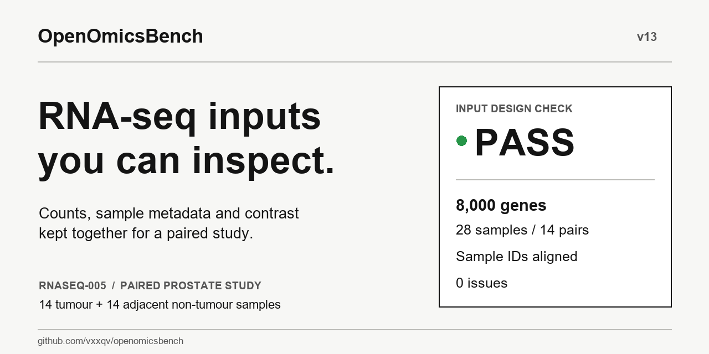
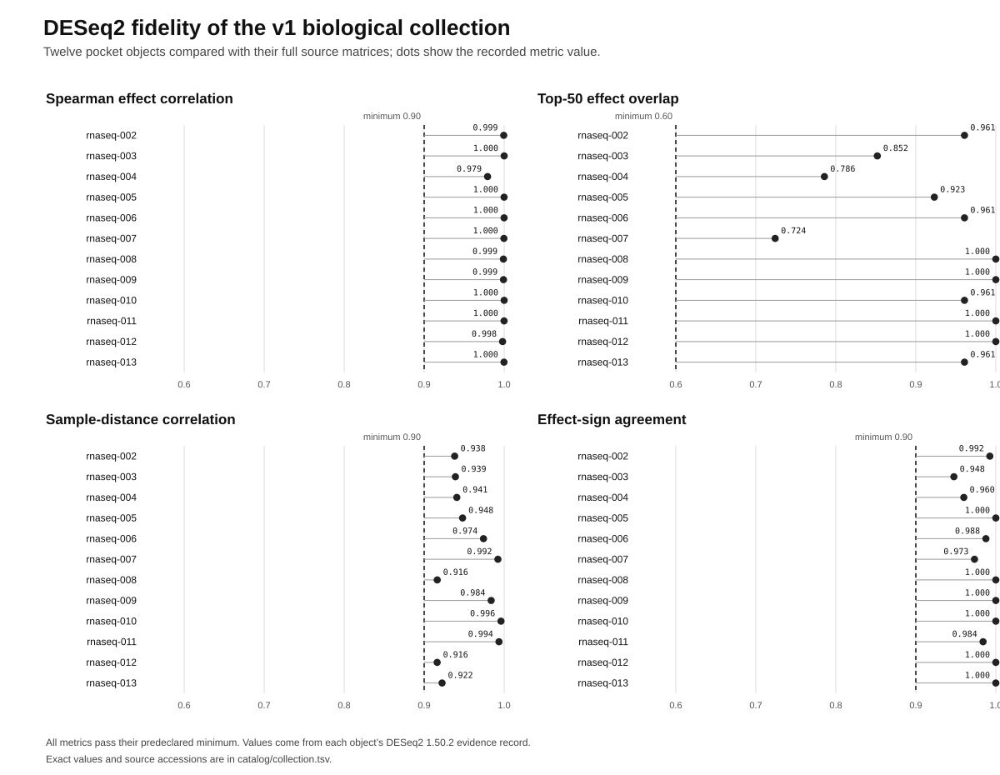

# OpenOmicsBench

[](https://bioconda.github.io/recipes/openomicsbench/README.html)
[](https://anaconda.org/bioconda/openomicsbench)
[](https://anaconda.org/bioconda/openomicsbench)
[](https://anaconda.org/bioconda/openomicsbench)
[](https://anaconda.org/bioconda/openomicsbench)
[](https://anaconda.org/bioconda/openomicsbench)
[](https://anaconda.org/bioconda/openomicsbench)

Install the [Bioconda package](https://anaconda.org/bioconda/openomicsbench) with `conda install bioconda::openomicsbench`. It has reached about 1.7k downloads across its releases.

If OpenOmicsBench helps your work, please [star the repository](https://github.com/vxxqv/openomicsbench). Stars help other people discover the repository.

OpenOmicsBench is a compact benchmark collection and local toolkit for bioinformatics software testing, method checks and teaching. It contains 12 certified bulk RNA-seq objects, seven deterministic sequence and classification fixtures, a 10x-style single-cell RNA-seq benchmark, a genomic peak-calling benchmark, strict local tools, and a CI-ready evaluation system. [Browse the collection](https://vxxqv.github.io/openomicsbench/) before installing.

## Try one RNA-seq study

`rnaseq-005` is a paired prostate tumour and adjacent non-tumour study. After [installing the package](#install), export its compact input pack and check the design:

```sh
omicsbench rnaseq pack tumour-example --id rnaseq-005
omicsbench rnaseq verify-pack tumour-example
omicsbench rnaseq check-design tumour-example/rnaseq-005/counts.tsv tumour-example/rnaseq-005/samples.tsv tumour-example/rnaseq-005/contrasts.tsv --id rnaseq-005
```

The JSON report from this run returns `pass`: 8,000 genes, 28 samples in 14 pairs, matching sample IDs and no design issues. A pipeline maintainer can use the same check on their own count matrix, sample sheet and contrast before running differential expression. The check verifies input consistency and a full-rank fixed-effect design; it does not run the analysis.



The pack contains `counts.tsv`, `samples.tsv`, `contrasts.tsv` and `pack.json`. Adjacent non-tumour tissue is not a healthy control, and the pack does not include expected results. Omit `--id` to export all 12 biological RNA-seq objects, or add `--tier full` to export complete matrices. See [RNA-seq input packs](docs/rnaseq-packs.md) for the full file contract.

The package runs offline after installation. Sequence files stay on the local computer. The built-in tools cover inspection and lightweight preprocessing; they do not claim to replace aligners, variant callers, taxonomic classifiers or assay-specific statistical workflows.

## Install

OpenOmicsBench requires Python 3.11 or newer.

```sh
python -m pip install openomicsbench
omicsbench --version
omicsbench demo my-first-run
```

Open `my-first-run/report.html` for the example comparisons. The corresponding `report.json`, `reference-results/results.json` and `evidence.zip` are in the same output directory. The demo refuses to replace an existing directory.

List and validate the bundled benchmarks:

```sh
omicsbench list
omicsbench validate rnaseq-002
omicsbench validate sequence-004
omicsbench variant compare sequence-005 calls.vcf.gz
omicsbench peptide compare sequence-006 identifications.peptides.tsv
omicsbench validate singlecell-001
omicsbench cell compare singlecell-001 clusters.tsv
omicsbench validate interval-001
omicsbench interval compare interval-001 calls.narrowPeak
omicsbench validate sequence-007
omicsbench taxon compare sequence-007 assignments.kraken
```

The wheel contains the complete collection. A repository checkout and network connection are not required.

## Score your RNA-seq results

Once your pipeline has produced a native differential-expression result table, score it against the named benchmark's archived reference:

```sh
omicsbench rnaseq score-effects rnaseq-005 results/deseq2.csv
omicsbench rnaseq normalize-effects rnaseq-005 results/edger.tsv results/rnaseq-005.tsv
```

The converter recognizes common `log2FoldChange` and `logFC` headers, including a first unnamed gene-ID column from an R CSV export. It drops missing effects with a count in the report, rejects duplicate genes and ambiguous headers, and keeps effect direction unchanged. Use `--reverse-sign` only when the submitted contrast is the reverse of the benchmark's declared target minus reference. Scoring compares with the archived full-source DESeq2 reference and its declared thresholds; it does not establish biological truth. See [RNA-seq packs and result tables](docs/rnaseq-packs.md) for file contracts and limitations.

## Test your own results

Prepare a workspace for the benchmarks your pipeline supports:

```sh
omicsbench suite prepare my-run --id rnaseq-002 --id sequence-007
omicsbench suite verify-workspace my-run
```

The command copies checked input files into `my-run/inputs/` and writes `my-run/workspace.json`. That JSON lists each case's input roles and hashes, sample design, source citation, rights, limitations, expected result columns and suggested result filename. It does not copy expected answers into the workspace.

Run your pipeline against those inputs, then put its results under `my-run/results/`. The suggested names are `rnaseq-002.tsv` and `sequence-007.taxonomy.tsv`. Check how files will be routed before writing the result index:

```sh
omicsbench suite discover my-run
omicsbench suite discover my-run --write
omicsbench suite grade my-run
```

Discovery accepts all six comparable assay families. It recognizes benchmark IDs in result filenames or parent directories and checks named columns in RNA effect, peptide and cell-cluster tables. If a pipeline uses unrelated filenames or headers, supply an exact path or column mapping:

```sh
omicsbench suite discover my-run \
  --result rnaseq-002=analysis/effects.csv \
  --column rnaseq-002:gene_id=Geneid \
  --column rnaseq-002:log2_fold_change=log2FoldChange \
  --write
```

The command refuses ambiguous matches and writes `my-run/results/results.json` only when every selected case has a supported file and required headers. `--force` with `--write` replaces an existing index after results change. Discovery checks routing, headers and hashes; it does not score results or establish that a file has the right biological meaning. `suite grade` performs the benchmark comparison. For results outside a prepared workspace, `suite index RESULTS_DIRECTORY` remains available for explicit mappings.

Grading checks the workspace inputs again, scores only its selected cases, and writes `report.json`, `report.html`, `report.csv`, `report.xml` and `evidence.zip` inside `my-run/`. Missing or incorrect results appear as failed cases. Reports are preserved by default; use `suite grade my-run --force` only when you intend to replace them after changing results. This workflow tests file handling and declared benchmark outcomes; each object's limitations still apply.

## Use from Python

```python
from omicsbench import Collection

collection = Collection()
for item in collection.list(assay="bulk_rna_seq", status="validated", kind="real"):
    print(item["id"], item["title"])

benchmark = collection.get("rnaseq-002")
samples = benchmark.file(role="samples", tier="metadata")
print(samples)
print(benchmark.validate()["status"])

data = benchmark.rnaseq("pocket")
print(data.counts.shape, data.samples)
print(benchmark.compare_counts("my-rna-data/counts.tsv")["status"])
```

`file()` returns a declared path only after checking its size and SHA-256 digest. `Collection.prepare()`, `verify_workspace()`, `discover()`, `grade()` and `evaluate()` expose the same contracts as the CLI. The API uses the installed collection by default and works offline. Pass a collection path to `Collection(root=...)` only when using a separate checkout or local collection.

To use the biological RNA-seq counts in R, Python or another tool, export one object:

```sh
omicsbench rnaseq export rnaseq-002 my-rna-data
omicsbench rnaseq export rnaseq-002 my-full-data --tier full
```

Each new directory contains `counts.tsv` (genes in rows, samples in columns), `samples.tsv` (one row per sample in matching column order) and `export.json` with source attribution, limitations, dimensions and SHA-256 hashes. The compact `pocket` tier is the default; `full` uses the complete count matrix for the selected samples. Existing directories are preserved. The export checks the source file against its declared digest and refuses a mismatched sample order. These counts are for software tests and method development; consult each object's limitations before interpreting biological effects.

Check a count table after another program has read and written it, or verify the complete export:

```sh
omicsbench rnaseq check-counts rnaseq-002 my-rna-data/counts.tsv
omicsbench rnaseq verify-export rnaseq-002 my-rna-data
omicsbench rnaseq check-counts rnaseq-002 my-full-data/counts.tsv --tier full
```

`check-counts` matches genes and samples by ID, so a row or column reorder is allowed. It reports missing and extra IDs, changed integer counts and per-sample totals over shared genes. It passes only when the two ID sets and every aligned count agree exactly. `verify-export` also checks `export.json` and the sample table. A mismatch exits with status 2; malformed input exits with status 1. These commands check data integrity and interchange, not differential-expression performance or biological validity.

## Sequence tools

Run a strict combined QC report on FASTA, FASTQ or gzip-compressed input:

```sh
omicsbench seq qc reads.fastq.gz --molecule dna --adapter AGATCGGAAGAGC
```

Common operations include:

```sh
omicsbench seq stats reference.fasta.gz
omicsbench seq validate proteins.fasta --molecule protein
omicsbench seq pair-check sample_R1.fastq.gz sample_R2.fastq.gz
omicsbench seq trim reads.fastq.gz trimmed.fastq.gz --quality 20 --min-length 30
omicsbench seq filter trimmed.fastq.gz clean.fastq.gz --min-length 30 --max-ambiguity 0.05 --min-mean-quality 25
omicsbench seq sample clean.fastq.gz subset.fastq.gz --count 10000 --seed 7
omicsbench seq transform transcripts.fasta proteins.fasta --operation translate --frame 1
omicsbench seq protein-stats proteins.fasta --ph 7.4
omicsbench seq digest proteins.fasta --enzyme trypsin --missed-cleavages 1
omicsbench seq motif reference.fasta ACGTRG --both-strands
omicsbench seq kmers reads.fastq.gz --k 21 --canonical --top 50
omicsbench seq compare sample-a.fasta sample-b.fasta --k 21 --size 5000
```

The command suite supports:

- multiline FASTA and FASTQ, including `.gz` input and output;
- DNA, RNA and protein alphabets with IUPAC ambiguity symbols;
- sequence length, N50/L50, composition, GC, ambiguity and exact duplication statistics;
- FASTQ Phred+33 range checks, Q20/Q30 summaries and per-position quality;
- paired-read identity checks, interleaving and deinterleaving;
- fixed, adapter and end-quality trimming;
- filtering by length, GC, ambiguity and mean quality;
- deterministic sampling and deduplication;
- reverse complements, transcription, back-transcription and six translation frames;
- overlapping IUPAC motif searches and six-frame ORF discovery;
- canonical k-mer counts and deterministic bottom-k similarity sketches;
- amino-acid composition, molecular weight, hydropathy, charge, estimated pI, aromaticity and extinction estimates;
- trypsin, Lys-C, Arg-C and chymotrypsin digestion with missed-cleavage and peptide-length controls;
- record extraction with zero-based, half-open slices.

Commands that write files refuse to replace an existing output unless `--force` is supplied. Outputs are written through a temporary file and moved into place only after the operation succeeds. JSON reports go to standard output so they can be stored or checked in automated workflows.

The FASTA validator follows the nucleotide symbol expectations described by [NCBI](https://www.ncbi.nlm.nih.gov/genbank/fastaformat). FASTQ has no single formal specification; OpenOmicsBench accepts conventional multiline records with printable Phred+33 quality characters and requires the sequence and quality lengths to match. The [GA4GH-maintained HTS specifications](https://samtools.github.io/hts-specs/) describe the surrounding SAM, BAM, CRAM and VCF ecosystem.

The full command reference is in [docs/sequence-tools.md](docs/sequence-tools.md).

## Single-cell tools

Inspect a 10x-style feature-barcode matrix without loading a dense array:

```sh
omicsbench cell qc matrix.mtx barcodes.tsv features.tsv --feature-columns 3
```

The report includes matrix dimensions, nonzero entries, library totals, detected features per cell, zero-count cells and the mitochondrial count fraction. Plain and gzip-compressed inputs are accepted. Coordinates, counts and companion table dimensions are checked before statistics are returned.

`singlecell-001` contains 90 synthetic cells, 60 features, three cell states and two crossed batches. Score a clustering table with `cell_id` and `label` columns:

```sh
omicsbench cell compare singlecell-001 clusters.tsv
```

Cluster names may differ from the truth labels. The comparator uses label-invariant ARI and NMI, alongside purity and complete cell coverage. The object tests file handling, QC and recovery of a known synthetic partition. It does not validate biological cell-type annotation, normalization, integration, trajectory inference or batch correction.

## Genomic interval tools

Validate a BED or narrowPeak file and summarize its coordinates:

```sh
omicsbench interval qc calls.narrowPeak --chrom-sizes chrom.sizes
```

`interval-001` contains 12 deterministic peaks across two synthetic contigs. The fixture covers narrow peaks, one broad peak, a close doublet and positions near chromosome boundaries. Its binned bedGraph signal is small enough for unit tests and teaching while preserving a declared truth set.

```sh
omicsbench interval compare interval-001 calls.narrowPeak
```

Peak matches require at least 50% reciprocal overlap. The report separates interval-level precision, recall and F1 from base-pair precision, recall and F1, so extra calls and over-wide calls remain visible. Parsing follows the UCSC zero-based, half-open BED convention, checks chromosome bounds, and accepts BED3, BED6, narrowPeak and gzip-compressed files. The benchmark measures coordinate and overlap recovery. It does not assess alignment, blacklist filtering, replicate concordance or biological peak validity. See [the genomic interval guide](docs/genomic-intervals.md) for the exact contract.

## Mock taxonomy assignment

`sequence-007` contains three generated reference sequences and 48 paired reads. Twelve pairs deliberately have no unique reference assignment: six come from a shared segment and six from an absent background sequence. The reference headers and truth labels use project-local codes `1`, `2` and `3`; they are not NCBI taxonomic identifiers.

Compare read-level assignments written as `read_id` and `taxon_id` columns, or pass Kraken 2's standard five-column per-read output directly:

```sh
omicsbench taxon compare sequence-007 assignments.tsv
omicsbench taxon compare sequence-007 assignments.kraken
```

For a small exact-match teaching example, `omicsbench taxon classify reference.fasta reads_R1.fastq reads_R2.fastq calls.tsv` writes canonical assignments when reference IDs follow `mock_taxon_<code>`. It assigns `0` when neither mate identifies a unique reference. This narrow tool tests file handling and scoring; it is not a metagenomic classifier for biological samples.

## Benchmark suites

Validate the complete installed collection and save reports that can be attached to a CI run:

```sh
omicsbench suite validate --json reports/validation.json --markdown reports/validation.md --junit reports/validation.xml
```

The selection can be narrowed by assay or by repeating `--id`:

```sh
omicsbench suite validate --assay bulk_rna_seq
omicsbench suite validate --id rnaseq-002 --id sequence-005
```

To test a differential-expression pipeline across several biological objects, place each result in a directory under its benchmark ID. CSV and TSV are accepted, with optional gzip compression:

```text
results/
  rnaseq-002.tsv.gz
  rnaseq-003.csv
```

Then run:

```sh
omicsbench suite compare results --id rnaseq-002 --id rnaseq-003 --junit reports/comparison.xml
```

For a mixed bulk RNA, single-cell, chromatin, DNA, protein and mock-taxonomy run, add benchmark-named cluster, peak, VCF, peptide and read-assignment output alongside the expression tables:

```text
results/
  method.json
  rnaseq-002.tsv.gz
  singlecell-001.cells.tsv
  interval-001.narrowPeak
  sequence-005.vcf.gz
  sequence-006.peptides.tsv
  sequence-007.taxonomy.tsv
```

```sh
omicsbench suite evaluate results \
  --id rnaseq-002 \
  --id singlecell-001 \
  --id interval-001 \
  --id sequence-005 \
  --id sequence-006 \
  --id sequence-007 \
  --json reports/evaluation.json \
  --html reports/evaluation.html \
  --evidence reports/evaluation-evidence.zip
```

Pipeline outputs do not need to be renamed or moved into one flat directory. Index their existing relative paths and native headers:

```sh
omicsbench suite index results \
  --result rnaseq-002=rna/deseq2.csv \
  --result singlecell-001=single-cell/clusters.csv \
  --result interval-001=chromatin/peaks.narrowPeak \
  --result sequence-005=dna/final.vcf.gz \
  --result sequence-006=protein/identifications.tsv \
  --result sequence-007=taxonomy/assignments.kraken \
  --column rnaseq-002:gene_id=Geneid \
  --column rnaseq-002:log2_fold_change=log2FoldChange \
  --column singlecell-001:cell_id=Barcode \
  --column singlecell-001:label=Cluster \
  --column sequence-006:protein_id=Protein \
  --column sequence-006:peptide=Sequence \
  --column sequence-006:q_value=QValue
```

This writes `results/results.json`. Evaluation detects it automatically, verifies every recorded hash and applies the declared column mappings. A changed file, unsafe path, duplicate benchmark, unknown field or incompatible file type stops the run before scoring. Existing benchmark-named files continue to work when no manifest is present.

`method.json` is optional. When supplied, it records the exact method version, command, container or source revision, parameters, runtime, peak memory and thread count. Missing selected outputs fail as benchmark cases.

Compare several tools or parameter sets in one matrix:

```sh
omicsbench suite matrix \
  --method deseq2=results/deseq2 \
  --method edger=results/edger \
  --json reports/matrix.json \
  --csv reports/matrix.csv \
  --html reports/matrix.html
```

Use `evaluate-matrix` when each method directory contains a mixture of RNA tables, VCF calls and peptide tables:

```sh
omicsbench suite evaluate-matrix \
  --method current=results/current \
  --method candidate=results/candidate \
  --id rnaseq-002 \
  --id sequence-005 \
  --id sequence-006 \
  --html reports/multi-assay.html
```

The leaderboard uses pass counts and keeps assay metrics separate. It does not average unlike measurements into a single score.

Each evaluation records SHA-256 hashes for the submitted results and benchmark manifests, then builds a `run_fingerprint` from those hashes, the effective input contract and the validated method receipt. Local directory names and manifest formatting do not affect this identity.

Apply a checked-in policy to an evaluation before accepting a run:

```sh
omicsbench suite gate reports/evaluation.json policy.json \
  --json reports/gate.json \
  --junit reports/gate.xml
```

A policy can require named benchmarks, overall and per-assay pass rates, a method receipt, runtime and memory ceilings, and metric floors scoped to an assay or comparator. Missing required evidence fails the gate.

Track several accepted or candidate runs in chronological order:

```sh
omicsbench suite trend \
  --run v4.0=reports/v4.0.json \
  --run candidate=reports/candidate.json \
  --json reports/trend.json \
  --html reports/trend.html
```

Trend reports preserve each source fingerprint, method receipt, resource measurements, pass rate and per-benchmark metric history.

Use a previously accepted report as a regression baseline:

```sh
omicsbench suite regress accepted.json candidate.json --absolute-tolerance 0.01 --junit reports/regression.xml
```

Omit `--id` from `suite compare` to require results for all 12 comparable RNA-seq objects. Omit it from `suite evaluate` to require every benchmark with a supported comparator. A completed suite exits with status 0 when every check passes, status 2 when a benchmark, policy or regression gate fails, and status 1 for invalid input. Existing report files are protected unless `--force` is supplied. The [suite reference](docs/benchmark-suites.md) describes the file convention and report fields.

Verify an evaluation evidence crate without extracting it:

```sh
omicsbench evidence verify reports/evaluation-evidence.zip
```

## Portable bundles

Create a deterministic ZIP containing selected benchmarks, their manifests, declared files and the project licence material:

```sh
omicsbench bundle create rna-and-dna.zip --id rnaseq-002 --id sequence-005
omicsbench bundle verify rna-and-dna.zip
```

Bundle verification checks the complete file inventory, byte counts, SHA-256 digests and embedded dataset manifests without extracting the archive. Recreating the same selection with the same package version produces the same archive bytes. See [docs/portable-bundles.md](docs/portable-bundles.md).

## Assay profiles

The assay profiles explain what the local tools can check and where a dedicated workflow becomes necessary:

```sh
omicsbench assay list
omicsbench assay info whole-genome
omicsbench assay plan whole-genome sample_R1.fastq.gz sample_R2.fastq.gz --adapter AGATCGGAAGAGC
```

Profiles are available for whole-genome, exome, targeted-panel, bulk RNA-seq, single-cell RNA-seq, ATAC-seq, ChIP-seq and related assays, amplicon sequencing, shotgun metagenomics, long-read DNA and RNA, genome or transcriptome references, RNA FASTA and protein FASTA. A plan contains executable validation and preprocessing commands plus a clear boundary for the downstream tools that still need a reference, database or assay-specific model.

## Bundled sequence benchmarks

| ID | Content | Format | Records |
|---|---|---|---:|
| `sequence-001` | DNA with IUPAC ambiguity and an exact duplicate | FASTA | 4 |
| `sequence-002` | coding, ambiguous and short RNA records | FASTA | 3 |
| `sequence-003` | standard, ambiguous and terminating protein records | FASTA | 3 |
| `sequence-004` | paired DNA reads with mixed qualities and duplication | FASTQ | 4 pairs |
| `sequence-005` | paired DNA-seq reads, reference and three known SNVs | FASTQ | 20 pairs |
| `sequence-006` | protein FASTA and exact in-silico tryptic peptide truth | FASTA/TSV | 3 proteins |
| `sequence-007` | paired mock-community reads and read-level taxonomy truth | FASTQ/TSV | 48 pairs |

These seven objects are project-authored synthetic fixtures. Each has an exact file inventory, checksums, format and molecule declarations, expected summary metrics and a deterministic rebuild workflow. `sequence-005` verifies that every truth-set reference allele matches the bundled reference and that every alternate allele is supported by the paired reads. `sequence-006` verifies exact protein-peptide pairs from a declared tryptic digest. `sequence-007` checks read-level labels against exact mock-reference matches. The objects test software behavior and do not represent a biological cohort or sequencing instrument.

The version 3 VCF comparator for `sequence-005` matches contig, one-based position, REF and ALT exactly. It reports precision, recall and F1 for A/C/G/T substitutions and verifies REF against the packaged synthetic reference. Genotypes, indels, complex representations and confident-region stratification are outside this fixture. Use a haplotype-aware benchmarking engine such as [hap.py](https://github.com/Illumina/hap.py) or vcfeval with an appropriate truth set and confident regions for real germline benchmarking; the [GA4GH benchmarking project](https://github.com/ga4gh/benchmarking-tools) documents that broader problem.

The version 4 peptide comparator accepts `protein_id` and `peptide` columns, with an optional `q_value` column. It scores unmodified pairs after the declared q-value filter and reports peptide precision, recall and F1, protein recall and covered truth residues. It does not parse spectra or claim to replace a full identification standard. The [HUPO-PSI mzIdentML specification](https://github.com/HUPO-PSI/mzIdentML) is the appropriate interchange model for complete mass-spectrometry identification results.

## Bulk RNA-seq benchmarks

Version 4 retains the complete version 1 biological collection unchanged.

| ID | Design | Samples | Pocket genes |
|---|---|---:|---:|
| `rnaseq-002` | SLC2A5 knockout in A549 xenografts | 10 | 2,000 |
| `rnaseq-003` | AtRsgA knockout in Arabidopsis seedlings | 6 | 4,000 |
| `rnaseq-004` | Klf1 knockout in mouse erythroid tissue | 6 | 4,000 |
| `rnaseq-005` | Paired prostate tumour and adjacent tissue | 28 | 8,000 |
| `rnaseq-006` | Arabidopsis infection adjusted for genotype | 12 | 500 |
| `rnaseq-007` | ELP3 depletion in BT549 cells | 6 | 8,000 |
| `rnaseq-008` | Duchenne muscular dystrophy myoblasts | 9 | 8,000 |
| `rnaseq-009` | Arabidopsis genotype adjusted for infection | 12 | 500 |
| `rnaseq-010` | Infection response in wild-type Arabidopsis | 6 | 500 |
| `rnaseq-011` | Infection response in gsnor1 Arabidopsis | 6 | 500 |
| `rnaseq-012` | Dmd-mdx myoblasts against wild type | 6 | 8,000 |
| `rnaseq-013` | Dmd-mdx-beta-geo myoblasts against wild type | 6 | 8,000 |

Each biological object includes the source counts for its selected samples, a smaller pocket matrix, ordered sample metadata, the declared design, source attribution, rights evidence, reference details, transformations and quantitative validation. All 12 pockets pass their predeclared DESeq2 fidelity thresholds.

Compare another tool's gene-level effects with a bundled full-source DESeq2 reference:

```sh
omicsbench compare rnaseq-002 results.csv
```

The input must contain unique `gene_id` and finite `log2_fold_change` columns. The report includes rank correlation, top-50 overlap, sign agreement, coverage and identifier differences. Status 0 means the declared checks passed, status 2 means a completed comparison missed a scientific threshold and status 1 means the input was invalid.



## Collection records

The [JSON catalog](catalog/collection.json) contains every benchmark family. [catalog/collection.tsv](catalog/collection.tsv) lists the biological objects, [catalog/sequences.tsv](catalog/sequences.tsv) lists the sequence fixtures, [catalog/single-cell.tsv](catalog/single-cell.tsv) lists the single-cell objects, and [catalog/intervals.tsv](catalog/intervals.tsv) lists genomic interval benchmarks.

Expression Atlas and BioStudies supplied the biological count matrices. Their bundled material is recorded as CC BY 4.0 with provider attribution. The sequence fixtures and software are project-authored and distributed under Apache-2.0. Project-written descriptive metadata is CC BY 4.0.

The objects are research and software-test material. They are not clinical references and do not replace the complete source studies.

## Development checks

```sh
python -m unittest discover -s tests -v
python workflows/build_sequence_fixtures.py
python workflows/build_singlecell_fixture.py
python workflows/build_interval_fixture.py
python scripts/build_catalog.py
python scripts/audit_collection.py
python scripts/check_repository.py
python scripts/certify_release.py --preflight
```

The repository checker validates every manifest, file inventory, byte count, SHA-256 digest and expected result. It also rejects undeclared files, schema drift, unsupported metadata and prohibited attribution traces.

## Citation

Zenodo releases list Vivaan Patni as the author. GitHub development and commits use the account `vxxqv`. Cite the exact archived release used in an analysis. The concept DOI [10.5281/zenodo.22551734](https://doi.org/10.5281/zenodo.22551734) resolves to the latest archived version.
